# OrbitGuard

**Avoiding one satellite should not put another in danger.**

OrbitGuard is a decision-support console for satellite close approaches, built and deployed on **IBM LinuxONE (s390x)** for the IBM Z Datathon 2026 (theme: *Real-Time AI for Critical Decisions*). It forecasts collision risk from real ESA conjunction alerts, and it screens avoidance burns against *every* nearby object, so a manoeuvre that dodges one object does not steer into another.

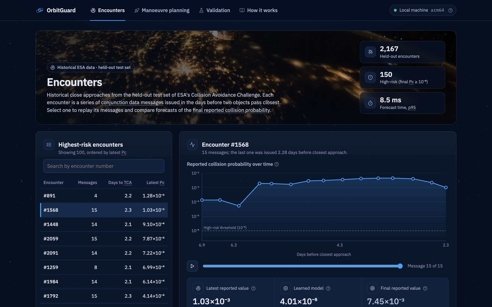

## Highlights

- **Real data, held-out evaluation.** 2,167 encounters from the ESA Collision Avoidance Challenge test set. The published ESA baseline loss is reproduced (0.694) before any claim is made.
- **The failure it prevents.** On a 50-scenario stress suite, avoiding only the original object created **20 secondary hazards**. OrbitGuard created **0**, for the same mean Δv.
- **Verified physics.** All 3 NASA CARA reference collision-probability cases pass, plus 7 invariance checks.
- **Fast on LinuxONE.** Forecast p95 **8.5 ms**. Screening 37 candidate burns with re-verification, p95 **1.71 s**. Parallel screening is **2.77×** faster on 3 workers.
- **Honest by construction.** Every number in the UI is read from generated evaluation artifacts. Missing results show as unavailable, never as invented values. Where the learned model loses (point forecasts), the console says so and keeps the baseline as the default.

## Screenshots

<table>
<tr>
<td width="50%">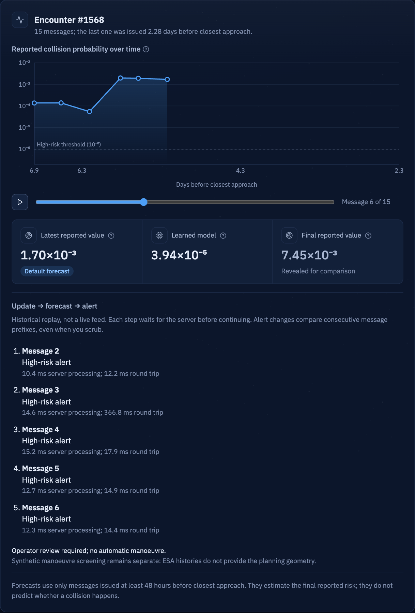<br/><sub><b>Replay.</b> Each historical message is processed on the server; the alert state and measured latency are shown per step.</sub></td>
<td width="50%">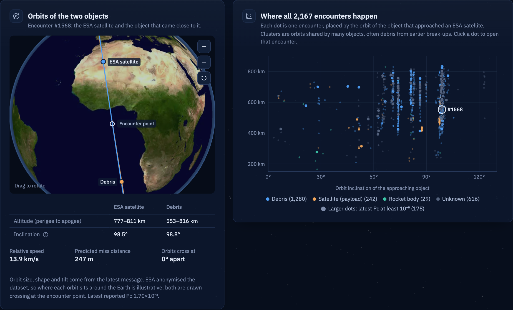<br/><sub><b>Encounter orbits and population.</b> The two orbits of the selected encounter, and all 2,167 encounters by inclination and altitude.</sub></td>
</tr>
<tr>
<td width="50%">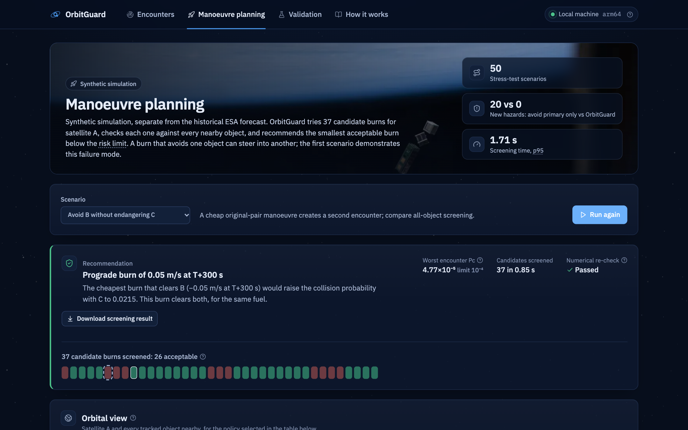<br/><sub><b>Manoeuvre planning.</b> The recommendation, the numerical re-check, and all 37 candidate burns (green acceptable, red rejected).</sub></td>
<td width="50%">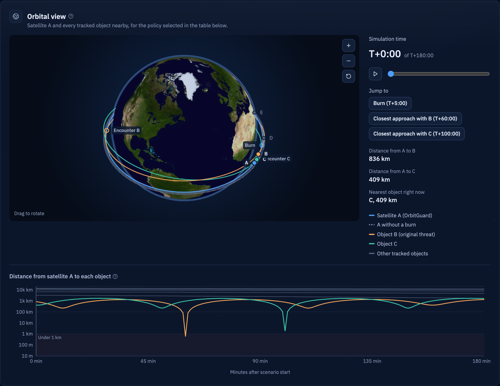<br/><sub><b>Orbital view.</b> Satellite A and every tracked object over the three-hour window, with A's distance to each object.</sub></td>
</tr>
<tr>
<td width="50%">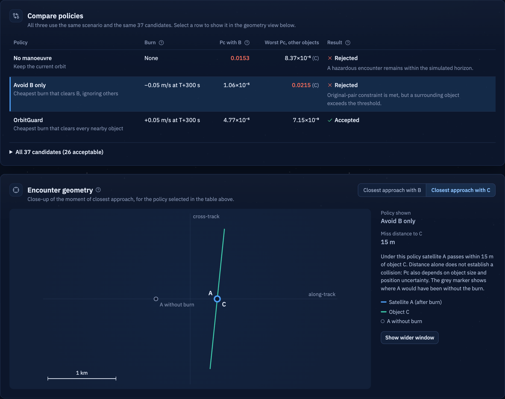<br/><sub><b>The secondary hazard.</b> Avoiding only B passes 15 m from object C. OrbitGuard picks a burn that clears both.</sub></td>
<td width="50%">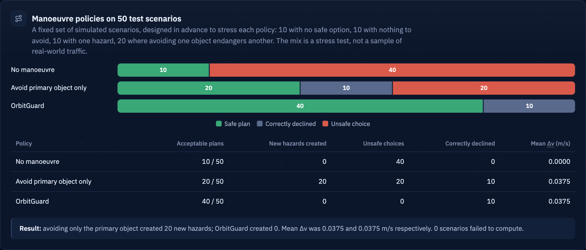<br/><sub><b>50-scenario suite.</b> Safe plans, correct abstentions and unsafe choices for each policy.</sub></td>
</tr>
<tr>
<td width="50%">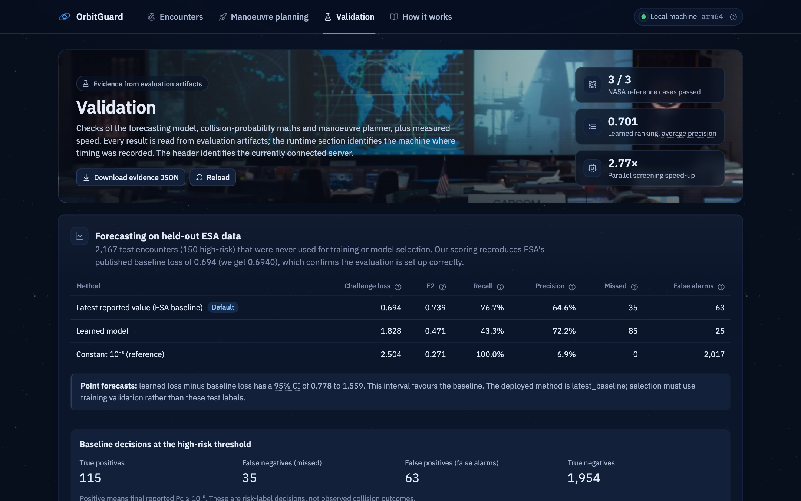<br/><sub><b>Validation.</b> Held-out metrics, confidence intervals, NASA cases and runtime, all rendered from artifacts.</sub></td>
<td width="50%">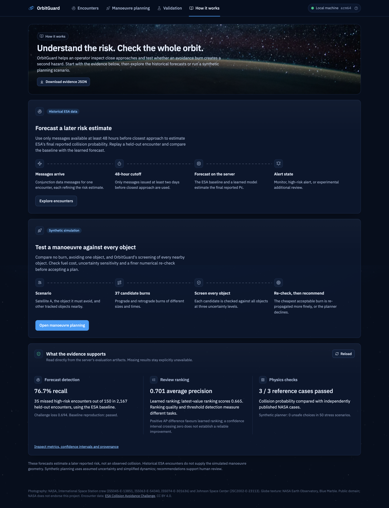<br/><sub><b>How it works.</b> The two independent evidence tracks, step by step.</sub></td>
</tr>
</table>

<p align="center">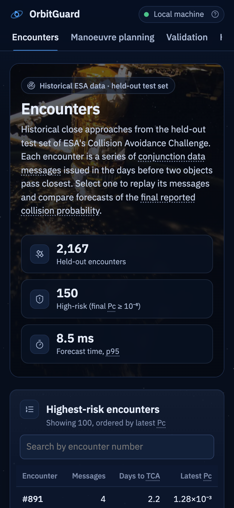</p>

<sub>Screenshots come from a local run of the console. Validation and How it works read the evaluation and timing artifacts produced on LinuxONE (see [docs/RESULTS.md](docs/RESULTS.md)); the header therefore shows the local machine.</sub>

## What it does

The console has four sections:

1. **Encounters.** Replays historical ESA conjunction data messages (CDMs) one at a time. Using only messages issued at least 48 hours before closest approach, it forecasts the final reported collision probability and ranks encounters for analyst review. An experimental learned rule can flag extra encounters for review without changing the default forecast.
2. **Manoeuvre planning.** A synthetic orbital neighbourhood. OrbitGuard screens 37 candidate burns against every nearby object at three uncertainty levels, rejects any burn that creates a secondary hazard, recommends the lowest-Δv acceptable option, and declines when nothing is acceptable.
3. **Validation.** Held-out forecasting metrics with bootstrap confidence intervals, NASA reference cases, the policy stress suite, runtime on LinuxONE, and data provenance.
4. **How it works.** A plain-language walkthrough of both tracks.

Every technical term (Pc, CDM, TCA, F2, average precision and others) has a keyboard-accessible tooltip.

More detail: [accuracy review](docs/ACCURACY_REVIEW.md), [judging guide](docs/JUDGING_GUIDE.md), [missed-alert improvement](docs/RECALL_IMPROVEMENT.md), [event-to-alert replay](docs/EVENT_REPLAY.md), [prerequisite labs on LinuxONE](docs/labs/README.md).

## Interface design

The visual system is documented in [DESIGN.md](DESIGN.md). In short: a deep-space dark theme whose palette came from a Google Stitch design system, one blue accent, green and red reserved for status, IBM Plex type, NASA photography in each page header, and motion used only where it explains something (replay, screening progress, step diagrams). All motion is disabled for users who prefer reduced motion.

## Prerequisite labs (completed on LinuxONE)

Both IBM AI/ML labs from [linuxone-community-cloud/jupyter-lab-ml](https://github.com/linuxone-community-cloud/jupyter-lab-ml) were run end to end on the team's LinuxONE VM, inside IBM's Jupyter Lab container, on 17 October 2026. Executed notebooks and details are in [docs/labs/](docs/labs/README.md).

| Lab | Notebook | Result on LinuxONE |
|---|---|---|
| 1. Predictive AI, multi-model | [Churn_Scikit_PyTorch](docs/labs/Churn_Scikit_PyTorch_executed_on_LinuxONE.ipynb): scikit-learn Random Forest (exported to PMML) and a PyTorch classifier | 31/31 cells, 0 errors, 18 s |
| 2. Predictive AI + Generative AI | [Loan_Approval_Demo](docs/labs/Loan_Approval_Demo_executed_on_LinuxONE.ipynb): IBM Granite LLM (llama.cpp with zDNN/NNPA) extracts features, XGBoost scores risk, BM25 retrieves policy, the LLM writes the recommendation | 9/9 cells, 0 errors, 65 s |

<table>
<tr>
<td width="50%"><br/><sub><b>Environment check.</b> Inside the lab container: s390x, IBM/S390, machine type 9175.</sub></td>
<td width="50%"><br/><sub><b>Lab 1.</b> Churn notebook running in Jupyter Lab on LinuxONE.</sub></td>
</tr>
<tr>
<td width="50%"><br/><sub><b>Lab 1.</b> Exploring churn drivers.</sub></td>
<td width="50%"><br/><sub><b>Lab 1.</b> PyTorch classifier training on s390x.</sub></td>
</tr>
<tr>
<td width="50%"><br/><sub><b>Lab 2.</b> llama.cpp built with zDNN/NNPA and the IBM Granite model.</sub></td>
<td width="50%"><br/><sub><b>Lab 2.</b> LLM feature extraction, then the XGBoost risk score (Low Risk, p = 0.997).</sub></td>
</tr>
</table>

## Results (measured on LinuxONE s390x)

The table below is the full LinuxONE pipeline run. For the later corrected predictor, fresh confidence intervals and regression run, see [the accuracy review](docs/ACCURACY_REVIEW.md).

Full tables, hashes, and the pipeline log are in [docs/RESULTS.md](docs/RESULTS.md), generated by `scripts/render_results.py`.

| Claim | Evidence |
|---|---|
| Our ESA scoring is correct | Published latest-risk baseline loss ≈ 0.694; we reproduce **0.69396** on the 2,167 held-out events. |
| Learned model improves triage *ranking* | Average precision **0.7005 vs 0.6651**; 95% paired-bootstrap CI for the difference **[+0.004, +0.064]**. |
| We do **not** claim a better point forecast | The learned residual GBM has a worse ESA loss (1.83 vs 0.69). Cross-validation chose the latest-risk baseline as the default forecast, before any test labels were read. |
| Collision-probability maths is correct | All 3 NASA CARA reference cases pass with relative error ≤ 3×10⁻⁶ (tolerance 10⁻³), plus 7 invariance and conservation checks. |
| Screening prevents secondary hazards | 50-scenario frozen suite: original-pair avoidance **introduced 20 secondary hazards**; OrbitGuard **0**. Same mean Δv (0.0375 m/s); 10/10 correct abstentions. |
| Real-time on LinuxONE | Forecast p95 **8.5 ms**. Full 37-candidate screening with re-verification p95 **1.71 s**. 3-worker parallel screening is **2.77×** faster. Training takes 111 s. |

## Architecture

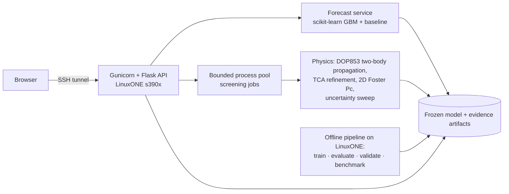

| Layer | Stack |
|---|---|
| UI | React + TypeScript + Vite, Recharts, three.js globes with NASA Blue Marble texture, SVG encounter geometry, Lucide icons, IBM Plex type (`frontend/`) |
| API | Flask behind Gunicorn, a systemd unit bound to loopback, gzip JSON (`orbitguard/api.py`) |
| ML | pandas + scikit-learn `HistGradientBoostingRegressor` residual on the latest risk; event-level 3-fold CV (`orbitguard/ml/`) |
| Physics | NumPy/SciPy `solve_ivp` (DOP853), encounter-plane Gaussian Pc, impulsive tangential burns (`orbitguard/physics/`) |
| Runtime | Ubuntu 24.04 s390x with native apt scientific stack; no compilation needed (`scripts/bootstrap-linuxone.sh`) |

### How a recommendation is made

1. Propagate the controlled satellite for each candidate: no action, plus burns at 300/900/1500 s × Δv ∈ ±{0.01, 0.05, 0.1, 0.25, 0.5, 1.0} m/s.
2. Find every closest approach with every surrounding object over the 3-hour horizon.
3. Compute Pc for each encounter at position-uncertainty scales of 0.5×, 1× and 2×.
4. Reject any candidate whose encounter exceeds Pc 10⁻⁴ at any scale, or that has a numerical failure.
5. Pick the smallest |Δv|. Break ties by lowest worst-case Pc, then earliest burn. If nothing passes: *"No acceptable manoeuvre in the evaluated candidate set."*
6. Re-verify the chosen plan with a tighter numerical setting.

Explanations are deterministic templates built from these numbers. No LLM sits in the decision path.

## Reproduce

### Laptop (development)

```bash
python3.12 -m venv .venv && .venv/bin/pip install -e '.[dev]'
.venv/bin/orbitguard fetch-data        # ESA dataset from Zenodo/ESA, CRC + SHA256 verified
.venv/bin/orbitguard prepare-data
.venv/bin/orbitguard train             # CV model selection, freezes model before labels
.venv/bin/orbitguard evaluate          # one-shot held-out evaluation + bootstrap
.venv/bin/orbitguard audit-accuracy    # raw-error audit, Wilson intervals, experimental shrinkage
.venv/bin/orbitguard train-triage      # optional experimental classifier, train-only selection
.venv/bin/orbitguard evaluate-triage   # retrospective evaluation of the frozen classifier
.venv/bin/orbitguard train-guard       # nested training validation; freeze supplemental review
.venv/bin/orbitguard evaluate-guard    # retrospective missed-alert/false-alarm comparison
.venv/bin/orbitguard validate-physics  # NASA CARA reference cases
.venv/bin/orbitguard benchmark-planner --count 50 --runtime-repetitions 20
.venv/bin/orbitguard benchmark-runtime
.venv/bin/python -m pytest -q
(cd frontend && npm ci && npm run build)
.venv/bin/orbitguard serve             # http://127.0.0.1:8000
```

### LinuxONE (the deployment that produced docs/RESULTS.md)

```bash
# from the laptop
python3 scripts/linuxone.py sync      --host <VM_IP> --key key.pem   # source + built UI; never keys/data
python3 scripts/linuxone.py sync-data --host <VM_IP> --key key.pem   # optional: reuse local download
# on the VM, in ~/orbitguard
bash scripts/bootstrap-linuxone.sh                 # apt numpy/scipy/pandas/sklearn/flask/gunicorn + venv
.venv/bin/orbitguard prepare-data
bash scripts/run-linuxone-pipeline.sh              # train → evaluate → validate → benchmarks
sudo cp deploy/orbitguard.service /etc/systemd/system/ && sudo systemctl enable --now orbitguard
# back on the laptop
python3 scripts/linuxone.py fetch-results --host <VM_IP> --key key.pem   # → artifacts/linuxone/
python3 scripts/render_results.py                                         # → docs/RESULTS.md
python3 scripts/linuxone.py tunnel --host <VM_IP> --key key.pem          # open http://localhost:8080
```

## Evaluation integrity

- **Official split only.** ESA numbers train and test events independently, so IDs are namespaced `train:<id>` / `test:<id>`. We confirmed zero exact duplicate CDMs across the splits. The raw archive, which contains test-related data, is never used for training.
- **48-hour cutoff.** Every forecast feature comes from messages at least 2 days before TCA. The API rejects later messages and any label-like fields.
- **Labels last.** The released label file is read for only `event_id` and `true_risk`, and only after the model file is frozen. The model's SHA256 is recorded before and after.
- **No hidden failures.** Undefined scores, abstentions and numerical failures are reported, never dropped. Missing artifacts show up in the UI as "pending", never as invented values.

## Honest limitations

- The ESA target is a *later reported risk estimate*, not an observed collision. ESA's splits over-represent high-risk events.
- The simulator uses two-body gravity, impulsive tangential burns, and prescribed RTN uncertainty (not propagated OD covariance). Slow co-orbital and horizon-edge encounters are out of scope.
- The 50-scenario suite is a stress-test design (10 clear / 10 primary / 20 secondary / 10 blocked), not operational prevalence.
- Secondary-encounter screening exists in operational practice (e.g. ESA's CA service). Our contribution is an integrated, measured, explainable prototype on LinuxONE.
- This is decision support for a human operator. It does not command spacecraft.

## Data and attribution

- ESA Collision Avoidance Challenge dataset, Zenodo record 4463683, **CC BY 4.0**, © European Space Agency.
- NASA CARA Analysis Tools reference test cases (commit `ce0f007…`), with Alfano (2009) test cases. Our Pc algorithm is an independent Python implementation.
- Interface photography: NASA, International Space Station crew (ISS045-E-13851, ISS063-E-54340, ISS074-E-301636) and Johnson Space Center (JSC2002-E-23113). Globe texture: NASA Earth Observatory, Blue Marble. NASA imagery is public domain; NASA does not endorse this project.

## Repository map

```
orbitguard/        api.py, runtime.py, __main__.py (CLI), ml/, physics/
frontend/          React console (built to frontend/dist, served by Flask)
tests/             API, ML (leakage/cutoff/scoring), physics (NASA + invariants)
scripts/           linuxone.py (sync/tunnel/fetch), bootstrap, pipeline, render_results.py
deploy/            systemd unit
docs/              RESULTS.md, ACCURACY_REVIEW.md, JUDGING_GUIDE.md, screenshots/, labs/, worklogs
```

